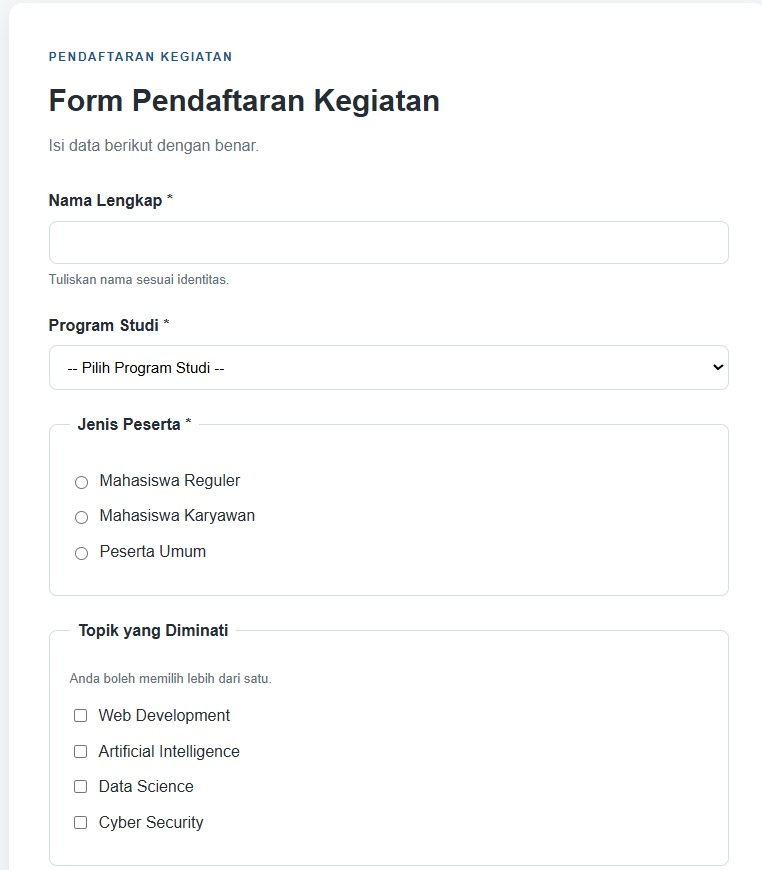

# LAPORAN PRAKTIKUM DESAIN WEB A
## Pertemuan 8: HTML Form Lanjutan - Pilihan, Upload, Textarea, dan Validasi HTML5


---

## 📋 Identitas Praktikan

| | |
|---|---|
| **Nama** | Nur Wahyu Muhtiin Haniv |
| **NIM** | 4525210078 |
| **Program Studi** | Teknik Informatika |
| **Fakultas** | Teknik |
| **Universitas** | Universitas Pancasila |
| **Mata Kuliah** | Praktikum Desain Web A |
| **Pertemuan** | 8 |

---

## 1. Tujuan Praktikum

1. Menggunakan *radio button* untuk pilihan tunggal dan *checkbox* untuk pilihan jamak.
2. Membuat daftar pilihan dengan `select` dan `option`, serta isian panjang dengan `textarea`.
3. Membuat kolom unggah berkas dengan `input type="file"` dan atribut `accept`.
4. Menerapkan validasi HTML5: `required`, `minlength`, `maxlength`, dan `pattern`.
5. Membedakan validasi *browser* (*client-side*) dan validasi *server* (*server-side*).
6. Menyusun *test case* validasi dan mendokumentasikan hasil tampilan desktop dan mobile.

---

## 2. Dasar Teori

### 2.1 Radio Button dan Checkbox

| Kontrol | Fungsi |
|---|---|
| `radio` | Memilih **satu** pilihan dari satu kelompok |
| `checkbox` | Memilih **lebih dari satu** pilihan |

Radio dengan atribut `name` yang sama menjadi satu kelompok. Checkbox memakai `name="sesi[]"` agar beberapa nilai terkumpul dalam satu *key*. Kelompok pilihan dibungkus `<fieldset>` dan diberi judul dengan `<legend>`.

### 2.2 Select, Textarea, dan File Upload

| Kontrol | Fungsi |
|---|---|
| `select` + `option` | Menampilkan pilihan dalam bentuk dropdown |
| `textarea` | Menerima teks panjang lebih dari satu baris |
| `input type="file"` | Memilih berkas dari perangkat pengguna |

Pengiriman berkas mewajibkan `method="post"` dan `enctype="multipart/form-data"` pada *form*.

### 2.3 Validasi HTML5

| Atribut | Fungsi |
|---|---|
| `required` | Mewajibkan input diisi atau dipilih |
| `minlength` | Menentukan jumlah karakter minimal |
| `maxlength` | Menentukan jumlah karakter maksimal |
| `pattern` | Menentukan format input memakai *regular expression* |

### 2.4 Validasi Browser dan Server

| Jenis | Keterangan |
|---|---|
| *Client-side* | Pemeriksaan oleh *browser* sebelum data dikirim, bertujuan memberi umpan balik cepat |
| *Server-side* | Pemeriksaan ulang oleh *backend* setelah data diterima, bertujuan menjaga keamanan dan keabsahan data |

> Validasi *browser* hanya membantu pengguna dan tidak bisa menjadi satu-satunya pertahanan, karena dapat dilewati.

---

## 3. Alat dan Bahan

| Kategori | Keterangan |
|---|---|
| **Bahasa** | HTML5 dan CSS3 |
| **Text Editor** | Visual Studio Code |
| **Browser** | Google Chrome / Microsoft Edge _(sesuaikan)_ |
| **Version Control** | Git dan GitHub |

---

## 4. Struktur Proyek

```
desain-web/
└── pertemuan-08/
    ├── index.html          # Form registrasi event
    ├── css/
    │   └── style.css
    ├── images/
    ├── dokumentasi/        # Screenshot desktop, mobile, dan pengujian
    └── README.md           # Laporan praktikum
```

---

## 5. Pembahasan dan Hasil

### 5.1 Form Registrasi Event

Form pendaftaran peserta **Seminar Teknologi Web 2026**. *Method* yang dipakai adalah **POST** dengan `enctype="multipart/form-data"` karena form mengirim berkas.

#### Struktur Field

| Field | Kontrol | Aturan Validasi | Keterangan |
|---|---|---|---|
| Nama Lengkap | `input text` | `required`, `minlength="3"`, `maxlength="60"` | Menerima nama peserta dengan batas 3-60 karakter. |
| NIM | `input text` | `required`, `pattern="[0-9]{10}"`, `maxlength="10"` | Menerima NIM berupa tepat 10 digit angka. |
| Email | `input email` | `required`, validasi format email | Menerima alamat email dengan pengecekan format bawaan browser. |
| Program Studi | `select` | `required` | Menampilkan pilihan program studi dalam bentuk dropdown. |
| Jenis Peserta | `radio` | `required` | Memilih satu jenis peserta dari tiga pilihan. |
| Sesi yang Diikuti | `checkbox` | - | Memilih satu atau lebih sesi menggunakan `name="sesi[]"`. |
| Alasan Mengikuti | `textarea` | `required`, `minlength="20"`, `maxlength="300"` | Menerima alasan peserta dengan batas 20-300 karakter. |
| Upload KTM | `input file` | `required`, `accept=".jpg,.jpeg,.png,.pdf"` | Memilih berkas identitas dengan filter format di pemilih file. |
| Foto Profil | `input file` | `accept="image/png, image/jpeg"` | Memilih foto opsional berformat JPG atau PNG. |
| Persetujuan | `checkbox` | `required` | Mewajibkan peserta menyetujui kebenaran data sebelum kirim. |

#### Struktur HTML

```html
<main class="container">
  <section class="form-card">
    <header class="form-header">...</header>
    <form action="/proses-registrasi" method="post" enctype="multipart/form-data">
      <div class="form-group">  <!-- nama, nim, email, program studi, alasan, upload -->
      <fieldset>                <!-- radio jenis peserta -->
      <fieldset>                <!-- checkbox sesi -->
      <div class="agreement">   <!-- persetujuan -->
      <div class="button-group"><!-- submit dan reset -->
    </form>
  </section>
</main>
```

#### Penerapan CSS

Warna dan sudut dikelola lewat **variabel CSS** pada `:root`. Tema yang dipakai adalah biru navy dengan aksen oranye amber: header berupa banner gelap, `legend` berlatar navy, dan tombol utama berubah menjadi oranye saat disentuh kursor. Pseudo-class `:user-invalid` dan `:user-valid` memberi warna merah atau hijau pada kolom setelah pengguna selesai mengisi.

```css
:root {
    --navy: #0d2137;
    --primary: #1f4e79;
    --accent: #f59e0b;
    --danger: #c62828;
    --radius: 8px;
}

input:user-invalid,
select:user-invalid,
textarea:user-invalid {
    border-color: var(--danger);
    background-color: #fff6f6;
}
```

#### Media Query

```css
@media (max-width: 600px) {
    .form-card    { padding: 24px; }
    .button-group { flex-direction: column; }
    .btn          { width: 100%; }
}
```

Pada layar kecil, tombol tersusun ke bawah dengan lebar penuh.

#### Hasil Tampilan Desktop



#### Hasil Tampilan Mobile


---

### 5.2 Test Case Validasi

Pengujian dilakukan dengan mengisi form secara sengaja salah, lalu menekan **Kirim Pendaftaran**. Pesan *browser* dapat berbeda sedikit antar *browser* dan bahasa.

| No | Field | Input Uji | Hasil yang Diharapkan | Hasil Aktual |
|---|---|---|---|---|
| 1 | Nama Lengkap | _(dikosongkan)_ | Form ditolak, muncul pesan kolom wajib diisi | Form ditolak, muncul pesan *"Please fill out this field"* |
| 2 | Nama Lengkap | `Al` (2 karakter) | Form ditolak karena kurang dari 3 karakter | Form ditolak, muncul pesan agar teks diperpanjang minimal 3 karakter |
| 3 | NIM | `12345#` | Form ditolak karena format tidak sesuai | Form ditolak, muncul pesan *"Please match the requested format"* |
| 4 | NIM | `123456789A` | Form ditolak karena mengandung huruf | Form ditolak, muncul pesan format tidak sesuai |
| 5 | Email | `ilham.email.com` | Form ditolak karena tidak memuat `@` | Form ditolak, muncul pesan agar email memuat `@` |
| 6 | Alasan | `Ingin belajar` (13 karakter) | Form ditolak karena kurang dari 20 karakter | Form ditolak, muncul pesan agar teks diperpanjang minimal 20 karakter |
| 7 | Jenis Peserta | _(tidak ada yang dipilih)_ | Form ditolak, pengguna diminta memilih salah satu | Form ditolak, muncul pesan *"Please select one of these options"* |
| 8 | Program Studi | `-- Pilih Program Studi --` | Form ditolak karena opsi kosong dipilih | Form ditolak, muncul pesan agar memilih item dari daftar |
| 9 | Upload KTM | `virus.exe` (dipilih lewat "All files") | Form ditolak karena format tidak diizinkan | **Form lolos validasi browser**, karena `accept` hanya filter di pemilih file |
| 10 | Persetujuan | _(tidak dicentang)_ | Form ditolak, pengguna diminta mencentang | Form ditolak, muncul pesan *"Please check this box if you want to proceed"* |

**Catatan:** Skenario 9 menunjukkan bahwa atribut `accept` bukan validasi sungguhan. Pengguna masih bisa memilih berkas lain, sehingga jenis berkas wajib diperiksa ulang di server.

---

### 5.3 Validasi yang Tetap Wajib di Server

Semua aturan HTML5 di atas hanya berjalan di *browser*. Aturan itu bisa dilewati lewat *DevTools*, menonaktifkan atribut, atau mengirim *request* langsung memakai alat seperti `curl` dan Postman. Karena itu server harus memeriksa ulang.

| Validasi di Server | Alasan |
|---|---|
| Semua field wajib terisi | Atribut `required` dapat dihapus dari *browser*. |
| Panjang dan format `nama`, `nim`, `alasan` | `minlength`, `maxlength`, dan `pattern` dapat dilewati. |
| Format email | `type="email"` hanya pengecekan dasar, bukan bukti email aktif. |
| Nilai `select`, `radio`, dan `checkbox` sesuai daftar yang diizinkan | Nilai dapat diubah menjadi nilai lain di luar pilihan. |
| Jenis berkas (MIME dan isi berkas), ukuran, dan nama berkas | `accept` hanya filter, berkas berbahaya bisa lolos. |
| NIM belum pernah terdaftar | Pengecekan duplikasi hanya mungkin dilakukan di basis data. |
| *Escape* data sebelum ditampilkan kembali | Mencegah serangan XSS dari teks yang dimasukkan pengguna. |

---

### 5.4 Ringkasan Perubahan, Masalah, dan Solusi

Pada tugas ini saya membangun form registrasi event yang memakai radio, checkbox, select, textarea, dan dua kolom upload. Perubahan utama dibanding pertemuan sebelumnya adalah penggunaan `fieldset` dan `legend` untuk mengelompokkan pilihan, serta `enctype="multipart/form-data"` agar berkas dapat dikirim. Saya menerapkan enam aturan validasi, yaitu `required`, `minlength`, `maxlength`, `pattern`, `type="email"`, dan `accept`. Tampilan juga ditambah umpan balik warna lewat `:user-invalid` dan `:user-valid` supaya kesalahan lebih mudah terlihat.

Masalah pertama muncul pada checkbox: HTML tidak menyediakan cara bawaan untuk mewajibkan minimal satu pilihan dalam satu kelompok. Karena itu kelompok sesi saya biarkan opsional, dan aturan wajib hanya dipasang pada checkbox persetujuan. Masalah kedua adalah atribut `accept` ternyata tidak menolak berkas dengan format lain, terbukti pada pengujian nomor 9. Solusinya adalah menganggap `accept` hanya sebagai petunjuk bagi pengguna dan mewajibkan pemeriksaan jenis serta ukuran berkas di server.

Dari pengujian sepuluh skenario, sembilan ditolak oleh *browser* dan satu lolos. Kesimpulannya, validasi HTML5 membantu pengguna, tetapi keamanan data tetap bergantung pada validasi server.

---

### 5.5 Catatan Pembagian Peran

Tugas ini dikerjakan secara individu, sehingga tidak ada pembagian peran kelompok.

---

## 6. Kesimpulan

1. Radio dipakai untuk satu pilihan, checkbox untuk banyak pilihan, dan keduanya dikelompokkan dengan `fieldset`.
2. Form yang mengirim berkas wajib memakai `method="post"` dan `enctype="multipart/form-data"`.
3. Atribut `required`, `minlength`, `maxlength`, dan `pattern` memberi validasi cepat di sisi *browser*.
4. Validasi *browser* bisa dilewati, sehingga validasi server tetap wajib untuk data dan berkas.